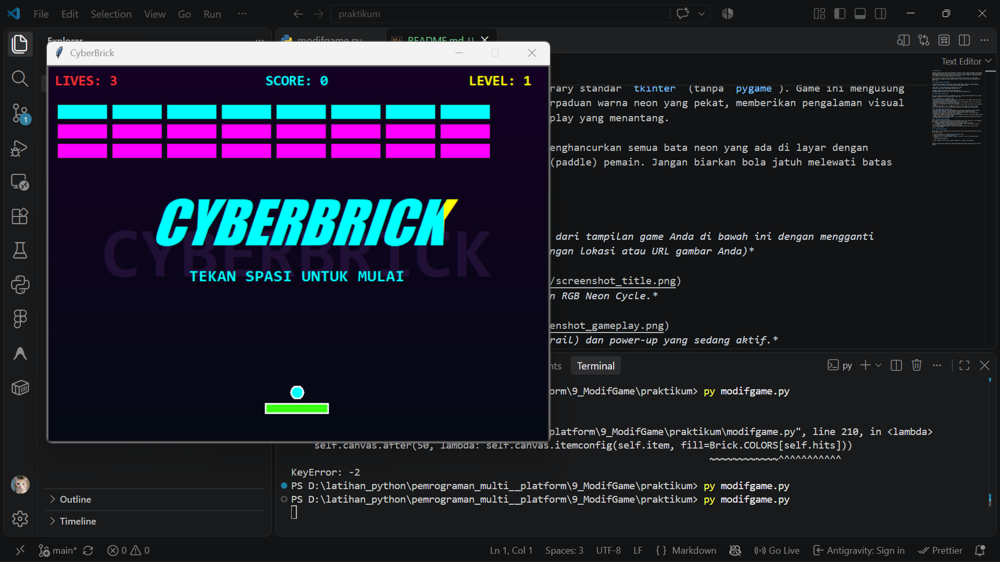
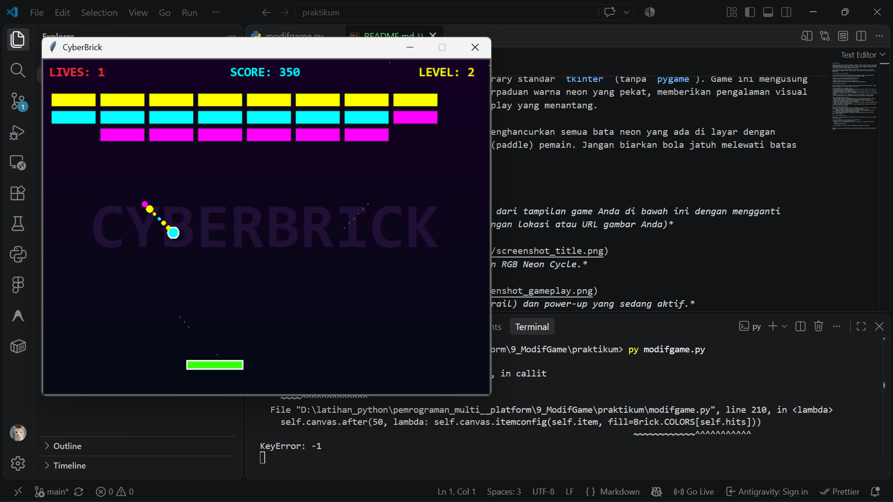
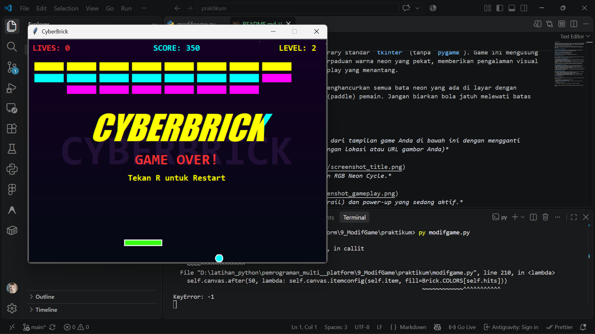

# CyberBrick 🕹️

CyberBrick adalah game klasik *Brick Breaker* (penghancur bata) bergaya *Arkanoid* yang dibangun menggunakan Python murni dengan library standar `tkinter` (tanpa `pygame`). Game ini mengusung tema **Modern Cyberpunk** dengan perpaduan warna neon yang pekat, memberikan pengalaman visual yang memanjakan mata sekaligus gameplay yang menantang.

Tujuan utama dari game ini adalah menghancurkan semua bata neon yang ada di layar dengan memantulkan bola menggunakan papan (paddle) pemain. Jangan biarkan bola jatuh melewati batas bawah layar!

## 📸 Cuplikan Layar (Screenshots)


*Tampilan animasi judul utama dengan RGB Neon Cycle.*


*Gameplay dengan jejak neon (neon trail) dan power-up yang sedang aktif.*


*Tampilan halaman game over.*

## ✨ Modifikasi dan Fitur Baru

Kode ini merupakan modifikasi dan perombakan total dari template *Brick Breaker* dasar, dengan berbagai penambahan fitur dan mekanik baru, antara lain:

### 1. Perombakan Visual (Cyberpunk Theme)
- **Desain Warna Neon:** Menggunakan palet warna terang seperti Cyan, Magenta, Neon Green, dan Yellow yang kontras dengan latar belakang gelap.
- **Background Gradasi:** Latar belakang canvas tidak lagi menggunakan warna solid, melainkan gradasi dari ungu gelap (dark purple) ke biru pekat.
- **Neon Trail (Jejak Bola):** Bola kini meninggalkan jejak partikel warna-warni yang menghilang perlahan.
- **Animasi Judul RGB:** Judul "CYBERBRICK" yang besar muncul dengan font tebal (`Impact` italic) dan berganti-ganti warna setiap 100ms ketika awal permainan dan saat *Game Over*.

### 2. Peningkatan Mekanik & Gameplay
- **Gerakan Super Mulus (60 FPS):** Mengubah sistem input dari *discrete key press* menjadi *continuous state checking*, sehingga pergerakan paddle sangat responsif dan halus.
- **Sistem Level:** Setelah semua bata hancur, pemain akan naik level. Susunan bata akan diperbarui dan kecepatan awal bola akan terus meningkat.
- **Sistem Skor & HUD:** Penambahan antarmuka teks (Heads-Up Display) yang melacak *Nyawa (Lives)*, *Skor*, dan *Level* secara *real-time*.
- **Restart Cepat:** Fitur menekan tombol `R` untuk mengulang permainan langsung setelah Game Over tanpa perlu menutup aplikasi.

### 3. Sistem Power-Up Interaktif
Bata yang hancur memiliki peluang 25% untuk menjatuhkan kapsul neon (Power-Up). Jika ditangkap oleh paddle, akan memberikan efek temporer (aktif selama ~10 detik):
*   🔵 **Cyan (Expand):** Memperpanjang ukuran paddle pemain secara signifikan.
*   🟣 **Magenta (Laser):** Paddle menembakkan dua proyektil laser ke atas secara otomatis setiap 0.5 detik, yang dapat menghancurkan bata seketika.
*   🔴 **Red (Speed-Up/Tantangan):** Meningkatkan kecepatan pantulan bola secara drastis, menguji refleks pemain.

## 🚀 Cara Menjalankan Game

Karena game ini hanya menggunakan pustaka bawaan Python, Anda tidak perlu menginstal *library* pihak ketiga apa pun.

1. Pastikan **Python 3.x** sudah terinstal di komputer Anda.
2. Unduh atau salin file `cyberpunk_breaker.py`.
3. Buka terminal atau *command prompt*, arahkan ke direktori file, dan jalankan perintah:
   ```bash
   python cyberpunk_breaker.py
   ```
4. Tekan **SPASI** untuk memulai, gunakan **Panah Kiri / Kanan** untuk bergerak.

---